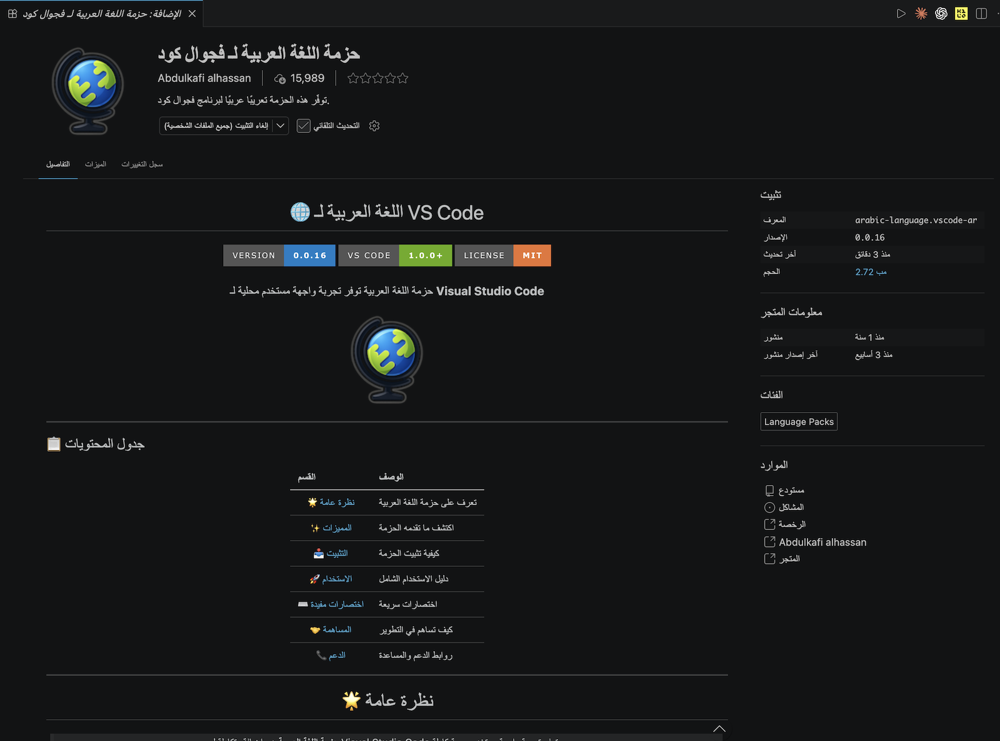

# Arabic Language Pack for Visual Studio Code

Arabic localization for Visual Studio Code, kept in sync with the latest Microsoft language-pack sources.

## Impact

| Metric | Value |
| --- | ---: |
| Acquisitions — last 30 days | 1,511 |
| Acquisitions — till date | 22,205 |
| Page views — last 30 days | 291 |
| Acquisition funnel | 519.24% (1.5K) |

Marketplace Insights reports 1,511 acquisitions in the last 30 days and 22,205 acquisitions to date. Its conversion funnel shows 291 page views and 1.5K acquisitions (519.24%). Checked on 2026-10-03; Marketplace metrics change over time.

## Screenshots

## Features

- Latest upstream localization structure from Microsoft.
- Coverage for the VS Code workbench and bundled extensions.
- Consistent Arabic terminology for UI-facing strings.
- Arabic UI wording reviewed against the upstream localization context.

## Installation

1. Open the Extensions view in Visual Studio Code.
2. Search for `Arabic Language Pack`.
3. Install the extension published by `Arabic-language`.
4. Run `Configure Display Language`.
5. Select `العربية` and reload VS Code.

## Usage

- Open the Command Palette with `Ctrl+Shift+P` or `Cmd+Shift+P`.
- Run `Configure Display Language`.
- Choose Arabic and restart if prompted.

## Contributing

Please read [CONTRIBUTING.md](./CONTRIBUTING.md) before making translation or tooling changes.

## Security

Please use the private reporting guidance in [SECURITY.md](./SECURITY.md).

## Release Process

1. Compare every localization file and `(section, key)` pair with the current French package.
2. Translate every new user-facing value and review placeholders and terminology.
3. Run the available JSON, localization, Markdown, and packaging checks.
4. Update `CHANGELOG.md` and the package version.
5. Inspect the VSIX, then publish the tagged release and extension.

## Roadmap

- Keep Arabic translations aligned with Microsoft upstream changes.
- Automate upstream key-coverage checks.
- Add CI validation for packaging and markdown quality.
- Improve reviewer guidance for terminology consistency.

## License

MIT. See [LICENSE.md](./LICENSE.md).
